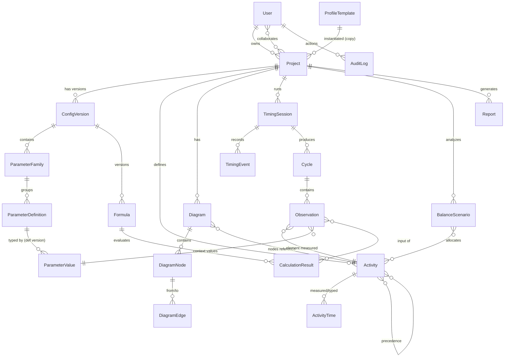

# فرهنگ داده و مدل مفهومی (DATA DICTIONARY)

**نسخه:** ۱٫۰ اولیه (فاز صفر) — **تاریخ:** ۲۹ اکتبر ۲۰۲۶
**هدف:** تعریف موجودیت‌ها، روابط، ناوردایی‌ها (invariants) و مرجع حقیقت هر داده؛ مبنای پیاده‌سازی Prisma در فاز ۱.
**قاعده:** تعریف پارامتر از مقدار پارامتر جداست؛ داده خام از داده مشتق‌شده جداست؛ هر نتیجه به نسخه روش قابل ارجاع است.

---

## ۱. نمودار ارتباط موجودیت‌ها (ER مفهومی)

## ۲. جدول موجودیت‌ها

قرارداد نام‌گذاری: شناسه‌های پایدار `id` (UUIDv7)؛ کلیدهای مخفی فقط داخلی. «مرجع حقیقت» یعنی مخزنی که داده در آن تعریف/صادر می‌شود.

### ۲.۱. Project — پروژه
| فیلد | نوع | توضیح |
|---|---|---|
| id | UUIDv7 | شناسه پایدار |
| code, title | متن | کد و عنوان |
| goal, location, department, line, station, product, process, owner, shift | متن اختیاری | زمینه B1 |
| status | enum | `active / archived / completed` |
| readiness | flags | آماده اندازه‌گیری/تحلیل/تأیید |
| profileSnapshotId | ref | کپی مستقل پروفایل لحظه ایجاد |
| currentConfigVersionId | ref | نسخه فعال پیکربندی |
| createdAt/updatedAt, notes | — | — |

**ناوردایی:** حذف منطقی (بایگانی)؛ دسترسی همیشه از مجوزسنجی سرور می‌گذرد.

### ۲.۲. ConfigVersion — نسخه پیکربندی
`id`, `projectId`, `semver`, `snapshotJson` (کل پیکربندی: خانواده‌ها، فرمول‌ها، تنظیمات آماری، قواعد بالانس)، `reason`, `createdBy`, `createdAt`.
**قاعده:** نسخه‌ها **غیرقابل تغییر** (append-only) هستند؛ هر تغییر ساختاری → نسخه جدید. نتایج محاسبه همیشه به `configVersionId` ارجاع دارند (ADR-005).

### ۲.۳. ProfileTemplate — الگوی پروفایل (سراسری، فقط‌خواندنی نسبت به پروژه‌ها)
`id`, `semver`, `nameFa`, `description`, `scope`, `source{type,name,version,url}`, `assumptions[]`, `limitations[]`, `licenseNote`, `content` (همان ساختار snapshot).
**قاعده:** لحظه ایجاد پروژه، `content` به `ConfigVersion` کپی می‌شود؛ تغییر الگو اثر گذشته ندارد.

### ۲.۴. ParameterFamily — خانواده پارامتر
`id`, `configVersionId`, `stableKey` (شناسه فنی پایدار)، `nameFa`, `order`, `archived`.

### ۲.۵. ParameterDefinition — تعریف پارامتر
`id`, `familyId`, `defVersion`, `stableKey`, `nameFa`, `description`, `helpFa`,
`dataType` (enum: `shortText,longText,integer,decimal,percent,ratio,duration,dateTime,boolean,singleSelect,multiSelect,quantityWithUnit,entityRef,computed`),
`required`, `defaultValue`, `min/max`, `precision`, `rounding`, `unit`, `allowedConversions[]`,
`options[]` + `optionsSource`, `conditionExpr` (عبارت DSL)، `computationFormulaId`,
`analysisRole` (enum: `input,grouping,filter,variable,outputIndex,informational`),
`displayContexts[]` (`form,table,chart,report`), `customAttrsJson`, `archived`.
**ناوردایی:** `stableKey` هرگز بازنویسی نمی‌شود؛ تغییر تعریف → `defVersion++` و تصمیم صریح مهاجرت مقادیر (بدون تبدیل پنهانی).

### ۲.۶. ParameterValue — مقدار پارامتر
`id`, `projectId`, `defId`, `defVersion` (نسخه تعریف هنگام ثبت)، `scopeType` (`project,session,cycle,observation,activity`),
`scopeId`, `valueJson` (به‌همراه واحد)، `recordedAt`, `recordedBy`.
**ناوردایی:** مقدار به نسخه تعریف لحظه ثبت گره خورده؛ تعریف جدید مقادیر قدیمی را بی‌سروصدا تبدیل نمی‌کند.

### ۲.۷. Activity — فعالیت/عنصر کاری (مدل مشترک B5)
`id`, `projectId`, `stableKey`, `name`, `description`, `workType` (enum توسعه‌پذیر: `operatorManual,machineAuto,waiting,transport,inspection,setupChangeover,overlap`),
`vaClassification` (nullable: `valueAdded,nonValueAdded,essentialNonVA` — فقط با تأیید کاربر)،
`constraintsJson` (ایستگاه مجاز، مهارت، تجهیز اختصاصی)، `stationHint`, `skillRequired`, `customParams` (ارجاع ParameterValue)،
`sourceOfTime` (enum: `measured,estimated,referenced`).
**رابطه تقدم:** جدال `ActivityPrecedence(activityId, predecessorId)` — جهت‌دار، بدون چرخه (اعتبارسنجی در فاز ۶).

### ۲.۸. ActivityTime — زمان نوع‌دار فعالیت
`id`, `activityId`, `timeType` (مطابق `workType` تفکیک دستی/خودکار/انتظار/حرکت/بازرسی/راه‌اندازی/هم‌پوشان)، `value`, `unit`, `basis` (`observed,representative,normal,standard`), `sourceRef` (ارجاع به Observation/فرمول/ورود دستی).

### ۲.۹. Diagram — نمودار
`id`, `projectId`, `kind` (enum: `opc, fpc`), `variant` (`current,proposed`), `title`, `subject` (برای FPC: `material,person,equipment`), `version`, `layoutJson` (چیدمان)، `summaryCache` (تعداد نمادها/زمان/مسافت — مشتق، بازسازی‌پذیر).

### ۲.۱۰. DiagramNode / DiagramEdge
Node: `id`, `diagramId`, `symbol` (OPC: `operation,inspection`; FPC: `operation,transport,inspection,delay,storage`), `stepNo`, `label`, `time`, `distance`, `location`, `activityRef` (اختیاری — اتصال به مدل فعالیت بدون کپی غیرقابل‌ردیابی), `customParams`.
Edge: `id`, `diagramId`, `fromNodeId`, `toNodeId`, `waypointsJson`, `directed=true`.
**اعتبارسنجی:** گام بدون اتصال، اتصال نامعتبر، شناسه تکراری، ترتیب ناسازگار (فاز ۳).

### ۲.۱۱. TimingSession — جلسه زمان‌سنجی
`id`, `projectId`, `method` (`continuous,snapback,laps`), `status` (`running,paused,stopped,recovered`), `observer`, `startedAtWall/endedAtWall` (زمان دیواری)، `perfOriginRef` (مرجع `performance.now()` شروع)، `elementAdvanceMode` (`manual,auto`), `deviceMeta`, `integrityFlags[]` (`visibilityLoss,sleepSuspected,clockRecovery,…`).

### ۲.۱۲. TimingEvent — رویداد (append-only)
`id` (UUIDv7 + `clientEventId` idempotent), `sessionId`, `type` (enum: `start,reading,pause,resume,stop,elementAdvance,correction,finalize`), `elementId?`, `cycleNo`, `perfElapsedMs` (monotonic درون جلسه), `wallClock` (ISO), `note`, `interruptionReason?`, `correctionOf?` (اصلاح به رویداد قبول‌شده، بدون حذف).
**ناوردایی:** رویدادها هرگز فیزیکی حذف/ویرایش نمی‌شوند؛ اصلاح = رویداد جدید با ارجاع (ADR-004).

### ۲.۱۳. Cycle — چرخه
`id`, `sessionId`, `seq`, `status` (`valid,incomplete,recovered,suspect`), `startedAtEventId/endedAtEventId`.

### ۲.۱۴. Observation — مشاهده
`id`, `cycleId`, `activityId`, `observedMs` (زمان مشاهده‌شده)، `readingMode` (`continuous,snapback,lap`), `ratingFactor?`, `validity` (`valid,flagged,rejected+reason`), `flags[]` (`outlierSuspect,recovered`), `note`.
**قاعده:** علامت‌گذاری پرت ≠ حذف؛ حذف از محاسبه فقط با قاعده انتخابی و ثبت علت.

### ۲.۱۵. Formula — فرمول
`id`, `configVersionId`, `stableKey`, `semver`, `nameFa`, `exprAst` (AST سریال‌شده DSL)، `scopeLevel` (`observation,element,cycle,cycleSet,group,project,balanceScenario`), `inputContract` (نام‌ها/انواع/واحدها)، `outputUnit`, `status` (`draft,active,deprecated`), `sourceRef`, `assumptions`.

### ۲.۱۶. CalculationResult — نتیجه محاسبه
`id`, `formulaId+formulaVersion`, `configVersionId`, `scopeType/scopeId` (ورودی‌ها)، `inputRefs[]` (شناسه مشاهدات/پارامترها)، `value+unit`, `status` (`valid,invalid,incomplete`), `errorMessages[]`, `traceJson` (مراحل ارزیابی)، `computedAt`, `computedBy`.
**ناوردایی:** قطعی و بازتولیدپذیر برای (ورودی یکسان + نسخه روش یکسان)؛ نتایج قبلی با نسخه جدید بی‌سروصدا جایگزین نمی‌شوند.

### ۲.۱۷. BalanceScenario — سناریوی بالانس
`id`, `projectId`, `name`, `taktTime` یا `demand+netAvailableTime+shifts`, `objectiveWeightsJson`، `algorithm` (`lcr,rpw,kilbridgeWester,manual,…`)، `algorithmVersion`, `solutionJson` (تخصیص فعالیت→ایستگاه + جدول نیرو)، `metrics` (`LB-010..030` — راندمان، تأخیر، حداقل نظری، گلوگاه)، `constraintsReport` (نقض/رعایت قیود)، `status` (`draft,solved,accepted`), `runMs`, `objectiveValue`.
**قاعده:** خروجی همیشه «بهترین راهکار یافت‌شده» مگر بهینگی اثبات‌شده؛ تخصیص دستی مجاز با اعتبارسنجی فوری.

### ۲.۱۸. Report — گزارش
`id`, `projectId`, `kind` (`projectSummary,observationsRaw,elementAnalysis,timeChain,balance,custom`), `templateRef`, `paramsJson` (فیلتر/ترتیب/ستون)، `dataSnapshotRefs` (به‌جای کپی داده)، `methodVersionRefs` (فرمول/پیکربندی)، `generatedAt/by`, `format` (`pdf,csv,xlsx,html`).

### ۲.۱۹. User / Role / AuditLog
User: `id, name, email, authProvider`; Role: `owner,editor,recorder,viewer,admin` (قابل توسعه — ADR-009). AuditLog: `id, userId, action, entityType/Id, before/afterJson, at` — برای حذف/اصلاح اندازه‌گیری و تغییر نسخه‌ها.

## ۳. مرجع حقیقت داده‌ها

| داده | مرجع حقیقت | مشتق/کش |
|---|---|---|
| رویدادها و مشاهدات خام | جدول TimingEvent/Observation (سرور پس از همگام‌سازی؛ IndexedDB = بافر آفلاین) | فقط کش |
| تعریف پارامتر/فرمول/تنظیمات | ConfigVersion (append-only) | — |
| مقادیر پارامتر | ParameterValue (سرور) | بافر آفلاین |
| زمان‌های نماینده/نرمال/استاندارد | CalculationResult (نسخه‌دار) | — |
| خلاصه نمودار | از DiagramNode بازسازی | summaryCache = کش |
| سناریو بالانس | BalanceScenario | — |

## ۴. جداسازی داده پروژه‌ها (زمینه‌ی A5)

۱. هر رکورد دامنه، `projectId` اجباری دارد و همه کوئری‌های سرور با `projectId + مجوز` فیلتر می‌شوند.
۲. `stableKey`ها فقط در فضای پروژه یکتا هستند.
۳. کپی پروژه = ایجاد ConfigVersion جدید از snapshot + کپی انتخابی (داده خام فقط با انتخاب صریح).
۴. AuditLog برای تغییرات بین-پروژه‌ای (کپی/انتقال) مسیر ردیابی دارد.
۵. نمونه آموزشی با برچسب `isDemo` در پروژه جدا و از نتایج واقعی ایزوله است (قاعده فاز ۱ سند جامع).

## ۵. راهبرد مهاجرت داده (چشم‌انداز)

- Prisma Migrate برای توسعه؛ `db push` ممنوع در محیط واقعی از فاز ۱ به بعد.
- هر تغییر schema با اسکریپت مهاجرت + تست رگرسیون «تعریف پارامتر/فرمول» (C2).
- استراتژی EAV-JSON برای پارامترهای پویا (ADR-010) به معنای عدم نیاز به مهاجرت ستونی برای هر پارامتر جدید است؛ مهاجرت فقط برای تغییر семانتیک تعریف‌ها با تبدیل صریح و ثبت در AuditLog.

## ۶. تصمیم‌های باز (برای فازهای بعد)

| موضوع | وضعیت |
|---|---|
| تفکیک فیزیکی جدول‌ها در SQLite به‌ازای موجودیت | نهایی در فاز ۱ همراه اولین Prisma schema اجرایی |
| فرمت دقیق `traceJson` | در فاز ۲ همراه موتور فرمول |
| ساختار `solutionJson` بالانس | در فاز ۶ همراه الگوریتم‌ها |
