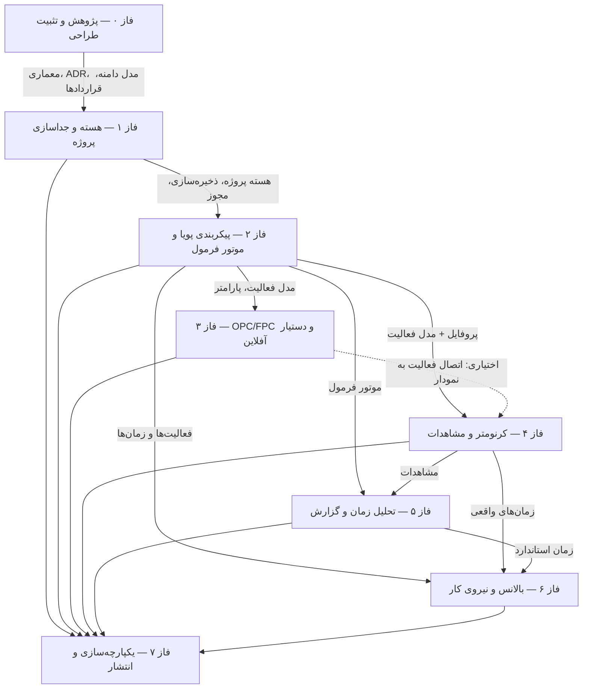

# ماتریس نیازمندی به آزمون و نقشه وابستگی فازها (TEST MATRIX)

**نسخه:** ۱٫۲ (به‌روزرسانی وضعیت فاز ۴) — **تاریخ آخرین به‌روزرسانی:** ۳۱ اکتبر ۲۰۲۶
**هدف:** نگاشت الزامات سند جامع (بخش C2) به انواع آزمون و فاز اجرا؛ مبنای «تست بدون شاهد، پذیرفته نیست».

---

## ۱. نقشه وابستگی فازها

**قراردادهای تحویلی بین فازها** (جزئیات در `ENGINE_CONTRACTS.md` §۵):
فاز ۲: `FormulaEngine` · فاز ۳: `DiagramDoc/Validation` · فاز ۴: `ChronoEngine/Clock` · فاز ۶: `BalanceProblem/Solution`

## ۲. ماتریس نیازمندی → آزمون

| # | نیازمندی (مرجع) | نوع آزمون | فاز اجرا | شاهد لازم | وضعیت فعلی |
|---|---|---|---|---|---|
| R0-1 | مستندات الزامی فاز صفر کامل باشند (E-فاز۰) | اسکریپت اعتبارسنجی `scripts/validate-phase0.mjs` | ۰ | خروجی اجرا | ✅ اجرا شد |
| R0-2 | نمونه اولیه UI قابل بررسی باشد (E-فاز۰ بند ۸) | بازبینی مرورگر + اسکرین‌شات | ۰ | اسکرین‌شات + گزارش | ✅ اجرا شد |
| R0-3 | کیفیت کد پایه | `bun run lint` | ۰ | خروجی بدون خطا | ✅ اجرا شد |
| R1-1 | ایجاد/بارگذاری مجدد پروژه پایدار | یکپارچگی API + SQLite آزمایشی | ۱ | خروجی تست | ✅ اجرا شد ۲۰۲۶-۱۰-۳۱ — `scripts/test-phase1.mjs` (۵۳/۵۳ ✓، شاهد: `docs/evidence/phase1-tests/`) |
| R1-2 | ویرایش پروژه A پروژه B را تغییر ندهد | یکپارچگی جداسازی | ۱ | خروجی تست | ✅ اجرا شد — همان اسکریپت (fingerprint کامل + نسخه‌ها + ممیزی) |
| R1-3 | درخواست مستقیم غیرمجاز API رد شود | امنیت (session/نقش/فیلتر projectId) | ۱ | خروجی تست | ✅ اجرا شد — ۴۰۱ بی‌نشست · ۴۰۴ کاربر دیگر · ۴۰۳ نقش ناکافی |
| R1-4 | بدون وابستگی حلقوی ماژول‌ها | `scripts/check-module-boundaries.mjs` (۱۱۵ فایل + DFS چرخه) | ۱ | خروجی اسکریپت | ✅ اجرا شد — ۰ نقض لایه · ۰ چرخه · exit 0 |
| R2-1 | پارامتر سفارشی بدون تغییر کد (E-فاز۲) | E2E فرم‌ساز+فرمول | ۲ | خروجی تست | ✅ اجرا شد ۲۰۲۶-۱۰-۳۱ — ۱۴ مرحله `bun run test:phase2` (۵۹/۵۹ ✓) + مسیر طلایی در مرورگر؛ شاهد: `docs/evidence/phase2-tests/integration-R2.txt` + `docs/evidence/phase2-screenshots/p2-01…11` |
| R2-2 | قطعیت و بازتولید نتیجه فرمول | واحد (داده مرجع) | ۲ | خروجی تست | ✅ اجرا شد ۲۰۲۶-۱۰-۳۱ — ۷ آزمون داده مرجع (TS-001/011/012/013، ST-001) + ارزیابی دوباره یکسان درون یکپارچگی؛ موتور ۴۴/۴۴ ✓ — شاهد: `docs/evidence/phase2-tests/unit-formula-engine.txt` + `integration-R2.txt` |
| R2-3 | شناسایی چرخه/تقسیم‌برصفر/واحد ناسازگار | واحد مرزی DSL | ۲ | خروجی تست | ✅ اجرا شد ۲۰۲۶-۱۰-۳۱ — ۱۲ آزمون یکپارچگی + ۱۵ آزمون واحد مرزی (چرخه/خودارجاعی · div0 پویا+ثابت · ارجاع/نوع/واحد · سقف ۶۴/۵۱۲/۲۰۴۸ · ۵ رشته تزریق کد بدون اجرا)؛ شاهد: `integration-R2.txt` + `unit-formula-engine.txt` |
| R3-1 | ساخت/ذخیره/بارگذاری/اعتبارسنجی نمودار | یکپارچگی | ۳ | خروجی تست | ✅ اجرا شد ۲۰۲۶-۱۰-۳۱ — §۴ R3-1: یکپارچگی API (۵ آزمون) + E2E مرورگر؛ شاهد: `integration-R3.txt` + p3-01…06 |
| R3-2 | کار آفلاین واقعی (قطع شبکه) | شبیه‌سازی آفلاین | ۳ | خروجی تست | ✅ اجرا شد ۲۰۲۶-۱۰-۳۱ — §۴ R3-E2: شبیه‌سازی قطع شبکه در مرورگر + idempotency (R3-5)؛ شاهد: `integration-R3.txt` |
| R4-1 | دقت monotonic و شمارنده ثانیه‌ای ممنوع | واحد + شبیه‌سازی visibility/reload | ۴ | خروجی تست | ✅ اجرا شد ۲۰۲۶-۱۰-۳۱ — ۴۷ آزمون واحد هسته با ManualClock (تشخیص خواب/بازگشت visibility + reconstruct/recover)؛ نمایش زنده rAF از perf در E2E — شاهد: `docs/evidence/phase4-tests/unit-timing-kernel.txt` + §۵ R4-E2 |
| R4-2 | idempotency رویداد (کلیک/retry تکراری) | واحد + یکپارچگی batch | ۴ | خروجی تست | ✅ اجرا شد ۲۰۲۶-۱۰-۳۱ — §۵ R4-5: ارسال دوباره همان ۱۲ رویداد → duplicates=12 بدون ingested؛ شمارش رویداد ثابت — شاهد: `integration-R4.txt` + E2E آفلاین (R4-E4) |
| R4-3 | بازیابی جلسه پس از reload با پرچم کیفیت | یکپارچگی + E2E | ۴ | خروجی تست | ✅ اجرا شد ۲۰۲۶-۱۰-۳۱ — §۵ R4-7: جلسه running → رویداد pause+clockRecovery پذیرفته؛ چرخه recovered + وقفه durationUnknown — شاهد: `integration-R4.txt` + p4-05/p4-06 |
| R5-1 | محاسبات با داده مرجع مستقل تطبیق کند | واحد (اعداد مرجع) | ۵ | خروجی تست | ⏳ فاز ۵ |
| R5-2 | اثر حذف مشاهده/تغییر فرمول با تاریخچه | رگرسیون | ۵ | خروجی تست | ⏳ فاز ۵ |
| R5-3 | خروجی CSV/XLSX/PDF با RTL سالم | بازبینی خروجی | ۵ | فایل خروجی | ⏳ فاز ۵ |
| R6-1 | راه‌حل‌ها هرگز قید تقدم را بی‌گزارش نقض نکنند | واحد الگوریتم‌ها | ۶ | خروجی تست | ⏳ فاز ۶ |
| R6-2 | شاخص‌ها با محاسبه مستقل تطبیق کند | واحد (مثال مرجع) | ۶ | خروجی تست | ⏳ فاز ۶ |
| R6-3 | تخصیص دستی با اعتبارسنجی فوری | E2E | ۶ | خروجی تست | ⏳ فاز ۶ |
| R7-1 | مسیر کامل ایجاد→گزارش | E2E (Agent Browser/Playwright) | ۷ | خروجی تست | ⏳ فاز ۷ |
| R7-2 | امنیت/آسیب‌پذیری/رازها | بازبینی + npm audit | ۷ | گزارش | ⏳ فاز ۷ |
| R7-3 | دسترس‌پذیری WCAG AA مسیرهای اصلی | بازبینی WCAG | ۷ | گزارش | ⏳ فاز ۷ |
| R7-4 | بازیابی پشتیبان آزموده‌شده | عملیاتی | ۷ | لاگ بازیابی | ⏳ فاز ۷ |

## ۳. قواعد اجرای آزمون‌ها

۱. هر فاز، آزمون‌های ردیف‌های خود را **واقعاً اجرا** و خروجی را در `PHASE_STATUS.md` با تاریخ/فرمان ثبت می‌کند.
۲. آزمون‌های واحد با داده مرجع مستقل (بدون مخلوط با داده واقعی) — قاعده بخش D.
۳. برای هر ردیفِ «قبول»، شاهد (خروجی/فایل/لاگ) مشخص است؛ «قبول با محدودیت» باید محدودیت را بنویسد.
۴. رگرسیون تعریف/فرمول (C2) در هر فازِ تغییرکننده مدل داده تکرار می‌شود.

---

## ۴. فاز ۳ — ردیف‌های ماتریس (۳۱ اکتبر ۲۰۲۶)

| نیازمندی (سند جامع/Phase3) | شناسه آزمون | روش | نتیجه | شاهد |
|---|---|---|---|---|
| ساخت OPC/FPC از ابتدا + ویرایش + بازیابی (پذیرش اصلی) | R3-1 | یکپارچگی API (۵ آزمون) + E2E مرورگر | قبول | integration-R3.txt + p3-01…06 |
| اتصال نامعتبر شناسایی شود (پذیرش) | R3-2 | یکپارچگی (۸ آزمون) + واحد | قبول | integration-R3.txt + unit |
| نسخه‌بندی append-only + بازیابی + تأیید | R3-3 | یکپارچگی (۵ آزمون) | قبول | integration-R3.txt |
| مقایسه روش فعلی/پیشنهادی | R3-4 | یکپارچگی (۴ آزمون) | قبول | integration-R3.txt |
| idempotency ذخیره آفلاین (بدون دوباره‌شماری) | R3-5 | یکپارچگی (۱ آزمون) + E2E آفلاین | قبول | integration-R3.txt + PUT 200 |
| RBAC diagrams (۴۰۱/۴۰۴/۴۰۳/read) | R3-6 | یکپارچگی (۶ آزمون) | قبول | integration-R3.txt |
| B5 پیش‌نیاز فعالیت (خودارجاعی/ناموجود/چرخه) | R3-7 | یکپارچگی (۴ آزمون) | قبول | integration-R3.txt |
| موتور اعتبارسنجی/خلاصه/چیدمان/SVG خالص | R3-U1 | واحد ۳۰ آزمون | قبول | unit-diagram-assistant-engines.txt |
| پارسر دستیار + قواعد + کتابخانه دانش | R3-U2 | واحد ۲۵ آزمون | قبول | همان فایل |
| خروجی تصویری (SVG/PNG/چاپ) | R3-E1 | E2E مرورگر + بازبینی فایل | قبول | p3-10/p3-11 + پنجره چاپ |
| کار آفلاین: طراحی/ذخیره/همگام‌سازی بدون خطای شبکه | R3-E2 | E2E شبیه‌سازی قطع شبکه | قبول | شبکه requests + r13 سرور |
| بازیابی پس از reload | R3-E3 | E2E reload کامل | قبول | p3-03 |
| رگرسیون فاز ۱/۲ | R3-R | test:phase1/2 | قبول (۵۳+۵۹) | regression-*.txt |
| مرزهای ماژول/چرخه | R3-B | check:boundaries | قبول (۰/۰) | boundaries.txt |

---

## ۵. فاز ۴ — ردیف‌های ماتریس (۳۱ اکتبر ۲۰۲۶)

| نیازمندی (سند جامع/Phase4) | شناسه آزمون | روش | نتیجه | شاهد |
|---|---|---|---|---|
| سناریوی مرجع کامل: ایجاد جلسه → ۱۲ رویداد → توقف → جزئیات با ۲ چرخه و داده مورد انتظار TS-003/TS-004/TS-005 | R4-1 | یکپارچگی API (۱۸ گام) | قبول | integration-R4.txt §۱ |
| وقفه: مکث با علت «خرابی فیکسچر» + مدت ~۳۰s از ساعت دیواری؛ زمان فعال بدون مکث (۹۲۰۰ms) | R4-3 | یکپارچگی (درون سناریوی مرجع) | قبول | integration-R4.txt §۱ |
| اصلاح قرائت با دلیل: آخرین اصلاح برنده · رویداد اصلی حفظ می‌شود (۱۳ رویداد) · تلورانس مجدد سازگار | R4-4 | یکپارچگی (۴ گام) | قبول | integration-R4.txt §۱ |
| idempotency batch: ارسال دوباره همان ۱۲ رویداد → duplicates=12، ingested=0، دوباره‌شماری نشد | R4-5 | یکپارچگی (۲ گام) | قبول | integration-R4.txt §۱ |
| نهایی‌سازی پس از stop: ذخیره ۲ چرخه در TimingCycle + قفل (رویداد جدید → 409) | R4-6 | یکپارچگی (۳ گام) | قبول | integration-R4.txt §۱ |
| بازیابی جلسه running پس از reload: رویداد pause+clockRecovery پذیرفته؛ چرخه recovered + وقفه durationUnknown (زمان جعل نمی‌شود) | R4-7 | یکپارچگی (۵ گام) | قبول | integration-R4.txt §۲ |
| روش بازگشت به صفر: مدت مستقیم splitMs (بدون تفاضل)؛ بدون کنترل تلورانس TS-005؛ readingMode=snapback | R4-8 | یکپارچگی (۳ گام) | قبول | integration-R4.txt §۳ |
| RBAC: ۴۰۱ بی‌نشست · ۴۰۴ پروژه دیگران · viewer فقط خواندن (۴۰۳) · recorder مجاز (نقش اصلی فاز ۴) | R4-9 | یکپارچگی (۷ گام) | قبول | integration-R4.txt §۴ |
| رد عنصر تعریف‌نشده در جلسه (۴۰۰) + خروجی خام JSON قابل بازیابی | R4-10 | یکپارچگی (۲ گام) | قبول | integration-R4.txt §۱ |
| ممیزی فقط چرخه عمر (session-created / session-finalized / event-corrected) + فهرست جلسات با KPI | R4-A | یکپارچگی (۵ گام) | قبول | integration-R4.txt §۵ |
| هسته خالص زمان‌سنجی (انواع / Clock / ChronoEngine / derive) — ManualClock، detectSleep، reconstruct/recover، اصلاح آخرین-برنده | R4-U1 | واحد ۴۷ آزمون (مجموع واحد پروژه: ۱۴۶/۱۴۶) | قبول | unit-timing-kernel.txt |
| مسیر طلایی E2E: ورود → کارگاه → جلسه جدید (سه منبع عنصر) → ثبت → دو چرخه → مکث با علت → توقف → نهایی‌سازی | R4-E1 | E2E مرورگر + اسکرین‌شات | قبول | p4-01…p4-10 |
| بازیابی reload در مرورگر: toast + بنر «بازیابی‌شده — نیازمند بررسی» | R4-E2 | E2E reload کامل | قبول | p4-05 / p4-06 |
| اصلاح رویداد با دلیل از صفحه جزئیات جلسه | R4-E3 | E2E مرورگر | قبول | p4-15 |
| آفلاین واقعی (set offline on/off): ثبت در قطعی → «در صف» → flush خودکار بدون دوباره‌شماری | R4-E4 | E2E شبیه‌سازی قطع شبکه | قبول | p4-12 / p4-13 / p4-14 |
| موبایل ۳۹۰px + RTL + فوتر چسبان + بدون خطای کنسول | R4-E5 | E2E بازبینی مرورگر | قبول | p4-16-mobile-workshop / p4-16-mobile-detail |
| رگرسیون فاز ۱/۲/۳ (هیچ قابلیت قبلی نشکست) | R4-R | test:phase1/2/3 | قبول (۵۳+۵۹+۳۸) | regression-phase1/2/3.txt |
| مرزهای ماژول/چرخه | R4-B | check:boundaries | قبول (۰ نقض/۰ چرخه) | boundaries.txt |
| lint / tsc | R4-L | `eslint .` · `tsc --noEmit` | قبول (exit 0) | lint.txt + tsc.txt |
