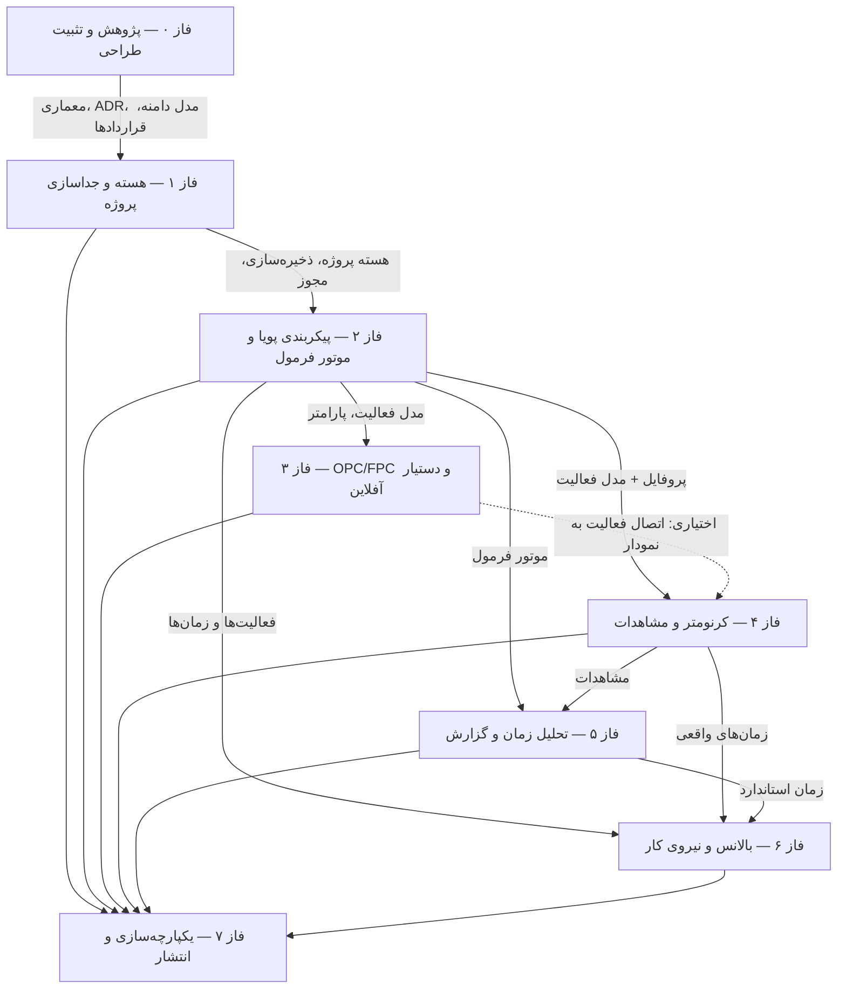

# ماتریس نیازمندی به آزمون و نقشه وابستگی فازها (TEST MATRIX)

**نسخه:** ۱٫۰ (فاز صفر) — **تاریخ:** ۲۹ اکتبر ۲۰۲۶
**هدف:** نگاشت الزامات سند جامع (بخش C2) به انواع آزمون و فاز اجرا؛ مبنای «تست بدون شاهد، پذیرفته نیست».

---

## ۱. نقشه وابستگی فازها

**قراردادهای تحویلی بین فازها** (جزئیات در `ENGINE_CONTRACTS.md` §۵):
فاز ۲: `FormulaEngine` · فاز ۳: `DiagramDoc/Validation` · فاز ۴: `ChronoEngine/Clock` · فاز ۶: `BalanceProblem/Solution`

## ۲. ماتریس نیازمندی → آزمون

| # | نیازمندی (مرجع) | نوع آزمون | فاز اجرا | شاهد لازم | وضعیت فعلی |
|---|---|---|---|---|---|
| R0-1 | مستندات الزامی فاز صفر کامل باشند (E-فاز۰) | اسکریپت اعتبارسنجی `scripts/validate-phase0.mjs` | ۰ | خروجی اجرا | ✅ اجرا شد |
| R0-2 | نمونه اولیه UI قابل بررسی باشد (E-فاز۰ بند ۸) | بازبینی مرورگر + اسکرین‌شات | ۰ | اسکرین‌شات + گزارش | ✅ اجرا شد |
| R0-3 | کیفیت کد پایه | `bun run lint` | ۰ | خروجی بدون خطا | ✅ اجرا شد |
| R1-1 | ایجاد/بارگذاری مجدد پروژه پایدار | یکپارچگی API + SQLite آزمایشی | ۱ | خروجی تست | ✅ اجرا شد ۲۰۲۶-۱۰-۳۱ — `scripts/test-phase1.mjs` (۵۳/۵۳ ✓، شاهد: `docs/evidence/phase1-tests/`) |
| R1-2 | ویرایش پروژه A پروژه B را تغییر ندهد | یکپارچگی جداسازی | ۱ | خروجی تست | ✅ اجرا شد — همان اسکریپت (fingerprint کامل + نسخه‌ها + ممیزی) |
| R1-3 | درخواست مستقیم غیرمجاز API رد شود | امنیت (session/نقش/فیلتر projectId) | ۱ | خروجی تست | ✅ اجرا شد — ۴۰۱ بی‌نشست · ۴۰۴ کاربر دیگر · ۴۰۳ نقش ناکافی |
| R1-4 | بدون وابستگی حلقوی ماژول‌ها | `scripts/check-module-boundaries.mjs` (۱۱۵ فایل + DFS چرخه) | ۱ | خروجی اسکریپت | ✅ اجرا شد — ۰ نقض لایه · ۰ چرخه · exit 0 |
| R2-1 | پارامتر سفارشی بدون تغییر کد (E-فاز۲) | E2E فرم‌ساز+فرمول | ۲ | خروجی تست | ⏳ فاز ۲ |
| R2-2 | قطعیت و بازتولید نتیجه فرمول | واحد (داده مرجع) | ۲ | خروجی تست | ⏳ فاز ۲ |
| R2-3 | شناسایی چرخه/تقسیم‌برصفر/واحد ناسازگار | واحد مرزی DSL | ۲ | خروجی تست | ⏳ فاز ۲ |
| R3-1 | ساخت/ذخیره/بارگذاری/اعتبارسنجی نمودار | یکپارچگی | ۳ | خروجی تست | ⏳ فاز ۳ |
| R3-2 | کار آفلاین واقعی (قطع شبکه) | شبیه‌سازی آفلاین | ۳ | خروجی تست | ⏳ فاز ۳ |
| R4-1 | دقت monotonic و شمارنده ثانیه‌ای ممنوع | واحد + شبیه‌سازی visibility/reload | ۴ | خروجی تست | ⏳ فاز ۴ |
| R4-2 | idempotency رویداد (کلیک/retry تکراری) | واحد صف | ۴ | خروجی تست | ⏳ فاز ۴ |
| R4-3 | بازیابی جلسه پس از reload با پرچم کیفیت | یکپارچگی | ۴ | خروجی تست | ⏳ فاز ۴ |
| R5-1 | محاسبات با داده مرجع مستقل تطبیق کند | واحد (اعداد مرجع) | ۵ | خروجی تست | ⏳ فاز ۵ |
| R5-2 | اثر حذف مشاهده/تغییر فرمول با تاریخچه | رگرسیون | ۵ | خروجی تست | ⏳ فاز ۵ |
| R5-3 | خروجی CSV/XLSX/PDF با RTL سالم | بازبینی خروجی | ۵ | فایل خروجی | ⏳ فاز ۵ |
| R6-1 | راه‌حل‌ها هرگز قید تقدم را بی‌گزارش نقض نکنند | واحد الگوریتم‌ها | ۶ | خروجی تست | ⏳ فاز ۶ |
| R6-2 | شاخص‌ها با محاسبه مستقل تطبیق کند | واحد (مثال مرجع) | ۶ | خروجی تست | ⏳ فاز ۶ |
| R6-3 | تخصیص دستی با اعتبارسنجی فوری | E2E | ۶ | خروجی تست | ⏳ فاز ۶ |
| R7-1 | مسیر کامل ایجاد→گزارش | E2E (Agent Browser/Playwright) | ۷ | خروجی تست | ⏳ فاز ۷ |
| R7-2 | امنیت/آسیب‌پذیری/رازها | بازبینی + npm audit | ۷ | گزارش | ⏳ فاز ۷ |
| R7-3 | دسترس‌پذیری WCAG AA مسیرهای اصلی | بازبینی WCAG | ۷ | گزارش | ⏳ فاز ۷ |
| R7-4 | بازیابی پشتیبان آزموده‌شده | عملیاتی | ۷ | لاگ بازیابی | ⏳ فاز ۷ |

## ۳. قواعد اجرای آزمون‌ها

۱. هر فاز، آزمون‌های ردیف‌های خود را **واقعاً اجرا** و خروجی را در `PHASE_STATUS.md` با تاریخ/فرمان ثبت می‌کند.
۲. آزمون‌های واحد با داده مرجع مستقل (بدون مخلوط با داده واقعی) — قاعده بخش D.
۳. برای هر ردیفِ «قبول»، شاهد (خروجی/فایل/لاگ) مشخص است؛ «قبول با محدودیت» باید محدودیت را بنویسد.
۴. رگرسیون تعریف/فرمول (C2) در هر فازِ تغییرکننده مدل داده تکرار می‌شود.
